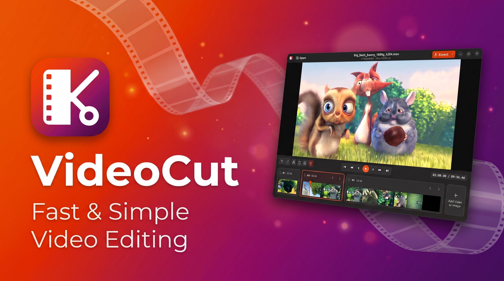

<p align="center">
  
</p>

# Video Cut 🎬

[](https://github.com/thor27/video-cut/releases/latest)
[](https://github.com/thor27/video-cut/releases)

An easy-to-use, fast, and lightweight video editor to cut and merge videos, add images with soundtracks, crop, and rotate clips on an intuitive timeline. Inspired by macOS QuickTime and Preview.

<p align="center">
  
</p>

## Download Latest Version

Pre-built packages are available on the **[Releases Page](https://github.com/thor27/video-cut/releases/latest)**:

- 📦 **[AppImage (`VideoCut-0.2.0-x86_64.AppImage`)](https://github.com/thor27/video-cut/releases/latest)** — Standalone portable package (runs on any modern Linux distribution without installation).
- 📦 **[Debian / Ubuntu Package (`video-cut_0.2.0_all.deb`)](https://github.com/thor27/video-cut/releases/latest)** — Install via `sudo apt install ./video-cut_0.2.0_all.deb`.
- 📦 **Windows Standalone (`.zip` / `.exe`)** — Standalone Windows executable and installer (see [WINDOWS_BUILD.md](WINDOWS_BUILD.md)).
- 📦 **[Source Archives (`.tar.gz` / `.zip`)](https://github.com/thor27/video-cut/releases/latest)** — Full source distribution.

All version releases, assets, and changelogs are available on the **[GitHub Versions Page](https://github.com/thor27/video-cut/releases)**.

## Features

- Frame-accurate video cutting, slicing, and trimming
- Merge multiple videos and images into a single timeline
- Interactive crop with freeform resizing and aspect ratio presets (16:9, 9:16, 1:1, 4:3, 3:4, 21:9, 9:21)
- Rotate (90° CW/CCW) and flip (horizontal/vertical) clips
- Import photos and graphics with customizable duration and optional background soundtrack
- Drag-and-drop segment reordering
- Universal clipboard copy & paste (videos, files, and images)
- Full undo and redo history for all editing operations
- Fast export with standard MP4 or advanced options (containers, codecs, CRF quality, speed presets, and audio formats)
- Hardware-accelerated preview playback
- Multilingual support (English, Portuguese, Spanish, French)

## Keyboard Shortcuts

| Shortcut | Action |
| :--- | :--- |
| <kbd>Space</kbd> | Play / Pause |
| <kbd>,</kbd> (comma) | Step backward 1 frame (~0.033s) |
| <kbd>.</kbd> (period) | Step forward 1 frame (~0.033s) |
| <kbd>Left</kbd> / <kbd>Right</kbd> | Step backward / forward 1 second |
| <kbd>Home</kbd> / <kbd>End</kbd> | Jump to start of previous / next segment |
| <kbd>S</kbd> | Split clip at playhead cursor |
| <kbd>C</kbd> | Crop, Rotate & Flip selected clip |
| <kbd>Ctrl+C</kbd> | Copy selected clip |
| <kbd>Ctrl+V</kbd> | Paste copied clip |
| <kbd>Delete</kbd> / <kbd>Backspace</kbd> | Delete selected clip |
| <kbd>Ctrl+Z</kbd> | Undo last edit |
| <kbd>Ctrl+Shift+Z</kbd> or <kbd>Ctrl+Y</kbd> | Redo undone edit |
| <kbd>Alt+Left</kbd> / <kbd>Alt+Right</kbd> | Move selected clip earlier / later |
| <kbd>Ctrl+O</kbd> | Open video or image file |
| <kbd>Ctrl+E</kbd> | Export with default options |

## Development

### Prerequisites

On Ubuntu / Debian:
```bash
sudo apt install python3-gi gir1.2-gtk-4.0 gir1.2-adw-1 gstreamer1.0-gtk4 ffmpeg
```

### Environment Setup & Running

Create a virtual environment that has access to system GTK 4 / PyGObject bindings, install in editable mode, and run:

```bash
# Set up a virtual environment sharing system site-packages (for GTK 4 bindings)
python3 -m venv --system-site-packages .venv
source .venv/bin/activate

# Install in editable mode (including pytest for testing)
pip install -e .
pip install pytest

# Run the application
video-cut

# Or open a video directly
video-cut /path/to/my_video.mp4
```

### Running Tests

```bash
pytest tests/
```

### Architecture

- `src/video_cut/models.py`: Core domain models (`Segment`, `ProjectTimeline`, `TransformState`) and snapshot-based undo/redo.
- `src/video_cut/services/`:
  - `probe_service.py`: `ffprobe` metadata extraction (duration, resolution, framerate, codecs).
  - `thumbnail_service.py`: Batched multi-input parallel thumbnail extraction engine with persistent disk index caching.
  - `image_service.py`: Image-to-video synthesis with customizable duration, aspect-ratio scaling, and optional audio track muxing.
  - `export_service.py`: FFmpeg `filter_complex` concatenation and rendering engine handling crops, rotations, flips, and audio synchronization; includes `FFmpegCapabilities` for dynamic detection of system encoders and muxers.
- `src/video_cut/i18n.py` & `src/video_cut/locale/`: Gettext runtime with automatic system locale detection and translation catalog files (`.po` / `.mo`) for `en_US`, `es`, `pt_BR`, and `fr`.
- `src/video_cut/player.py`: Hardware-accelerated playback pipeline supporting seamless multi-segment sequencing and live transformations.
- `src/video_cut/timeline_widget.py` & `segment_card.py`: Proportional timeline layout, dynamic thumbnail sizing (80px minimum), centralized orange playhead needle, and drag-and-drop sequencing.
- Dialogs:
  - `crop_rotate_dialog.py`: Interactive crop canvas with drag handles, rotation (90° CW/CCW), flip (H/V), and aspect ratio presets.
  - `image_import_dialog.py`: Modal for image import duration selection, background soundtrack attachment, and audio preview.
  - `advanced_export_dialog.py`: Advanced export modal configuring container formats, codecs, CRF quality, encoding speed, audio bitrates, and resolutions.
- `src/video_cut/window.py`: Libadwaita main application window with HeaderBar actions, edit toolbar, keyboard shortcuts, and state coordination.

### Packaging & Distribution

Build distribution packages directly using the scripts in `scripts/`:

```bash
# Build DEB, AppImage, and validate Snap and Flatpak
./scripts/build_packages.sh

# Or build individually:
./scripts/build_deb.sh        # Builds dist/video-cut_*.deb
./scripts/build_appimage.sh   # Builds dist/VideoCut-*.AppImage
./scripts/build_snap.sh       # Builds dist/video-cut_*.snap (requires snapcraft)
./scripts/build_flatpak.sh    # Builds dist/VideoCut-*.flatpak (requires flatpak-builder)
./scripts/build_windows.sh    # Builds dist/VideoCut-*.zip and Setup.exe (Windows / MSYS2)
```

Generated packages are placed in the `dist/` directory:
- **Debian Package (`.deb`)**: Install via `sudo apt install ./dist/video-cut_*.deb`
- **AppImage (`.AppImage`)**: Standalone binary `./dist/VideoCut-*.AppImage`
- **Snap Package (`.snap`)**: Install locally via `sudo snap install --dangerous ./dist/video-cut_*.snap`
- **Flatpak (`.flatpak`)**: Install locally via `flatpak install --user ./dist/VideoCut-*.flatpak` (see [FLATHUB_PUBLISHING.md](FLATHUB_PUBLISHING.md) for Flathub guide)
- **Windows Package (`.zip` / `.exe`)**: Standalone portable archive and installer for Windows (see [WINDOWS_BUILD.md](WINDOWS_BUILD.md))

#### Versioning

Video Cut uses a single source of truth for versioning defined in [`src/video_cut/__init__.py`](src/video_cut/__init__.py). Python packaging metadata (`pyproject.toml`), AppStream MetaInfo (`io.github.thomaz.videocut.metainfo.xml`), Snapcraft (`snap/snapcraft.yaml`), and all packaging scripts automatically adopt this version.

```bash
./scripts/set_version.sh --show    # Display current version
./scripts/set_version.sh 0.2.0     # Set a new version across the project
```

## Author

- **Thomaz Reis** — [@thor27](https://github.com/thor27)

## License

This project is licensed under the GNU General Public License v3.0 - see the [LICENSE](LICENSE) file for details.
