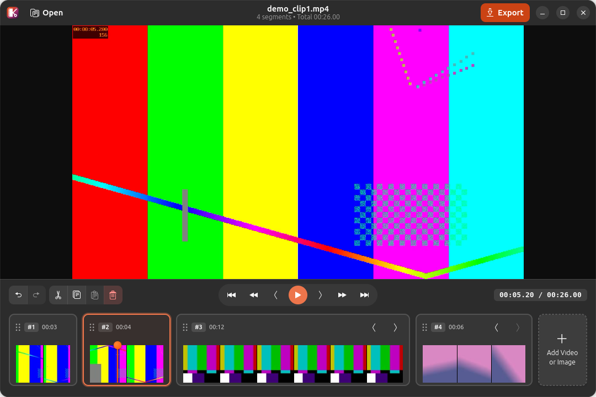

# Video Cut 🎬

A simple, fast, and modern Python GTK 4 / Libadwaita tool to edit and cut videos, inspired by macOS Preview and QuickTime video editing.

<p align="center">
  
</p>

## Features

- **Large Video Player**: Full preview canvas with zero hover obstructions, hardware-accelerated via GStreamer and GTK 4, featuring real-time preview of crop, rotation, and flip transformations.
- **Crop, Rotate & Flip**:
  - Interactive crop canvas with draggable bounding box and corner/edge handles.
  - Aspect ratio presets: Free, Original, 16:9, 9:16, 1:1, 4:3, and 21:9.
  - 90° clockwise (<kbd>⟳</kbd>) and counter-clockwise (<kbd>⟲</kbd>) rotation.
  - Horizontal (<kbd>⇄</kbd>) and vertical (<kbd>⇅</kbd>) flipping.
  - Fast keyboard access with <kbd>C</kbd>.
- **Proportional Filmstrip Timeline**:
  - Segments scale proportionally based on their duration relative to total timeline length.
  - Enforced minimum thumbnail width (80px) to prevent narrow, illegible slivers on short clips.
  - Intelligent single-thumbnail fallback for short segments.
  - Centralized orange playhead needle showing the exact cut position directly over frames.
- **High-Performance Thumbnail Engine**:
  - Parallel multi-threaded demuxer seek extraction (< 2.5s for 4-minute 1080p HEVC video).
  - Instant first-frame extraction (< 50ms) and persistent disk index caching for instantaneous project reloads.
  - Smooth animated spinner loading feedback while thumbnails are being generated.
- **Image Import with Duration & Soundtrack Attachment**:
  - Import photos and graphics (PNG, JPG, JPEG, WEBP, BMP, GIF, etc.) into the timeline as video clips.
  - Customizable clip duration (0.5s to 300s) with quick presets (1s, 3s, 5s, 10s).
  - Attach optional background music or voiceover soundtrack (`.mp3`, `.wav`, `.aac`, `.m4a`, `.ogg`, `.flac`).
  - Audio start offset slider and real-time audio slice preview player.
- **Internationalization (i18n)**:
  - Automatic system language detection (`LANG`, `LC_ALL`, `LANGUAGE`).
  - Native translations for:
    - 🇺🇸 **English** (`en_US` / default)
    - 🇪🇸 **Spanish** (`es`)
    - 🇧🇷 **Portuguese (Brazil)** (`pt_BR`)
    - 🇫🇷 **French** (`fr`)
- **Clipboard & Edit Toolbar**:
  - Dedicated edit toolbar directly below the canvas with Split (<kbd>S</kbd>), Copy (<kbd>Ctrl+C</kbd>), Paste (<kbd>Ctrl+V</kbd>), Crop & Rotate (<kbd>C</kbd>), Delete (<kbd>Del</kbd>/<kbd>Backspace</kbd>), and Move Left/Right (<kbd>Alt+Left</kbd> / <kbd>Alt+Right</kbd>).
- **Split at Cursor**: Slice clips at the cursor position (<kbd>S</kbd>, toolbar button, or right-click context menu).
- **Full Undo & Redo**: Unlimited undo/redo history for splits, deletions, reorders, paste operations, transformations, and clip additions (<kbd>Ctrl+Z</kbd>, <kbd>Ctrl+Shift+Z</kbd> / <kbd>Ctrl+Y</kbd>).
- **Reorder Segments**: Drag and drop clips or use Move Left (<kbd>◀</kbd> / <kbd>Alt+Left</kbd>) and Move Right (<kbd>▶</kbd> / <kbd>Alt+Right</kbd>).
- **Integrated Compact Transport Controls**:
  - Skip to previous / next segment (<kbd>Home</kbd> / <kbd>End</kbd>)
  - Previous / next single frame (<kbd>,</kbd> / <kbd>.</kbd>)
  - Step backward / forward 1 second (<kbd>Left</kbd> / <kbd>Right</kbd>)
  - Play / Pause (<kbd>Space</kbd>)
- **Quick Export & Export Options**:
  - One-click quick export (<kbd>Ctrl+E</kbd>) rendering standard MP4 with optimal settings.
  - Dropdown menu on the export button with an **Export options...** modal dynamically querying installed FFmpeg capabilities:
    - **Containers**: MP4 (`.mp4`), Matroska (`.mkv`), WebM (`.webm`), QuickTime (`.mov`).
    - **Video Codecs**: H.264 / AVC, H.265 / HEVC, VP9, AV1 (SVT-AV1 / libaom), Apple ProRes (`prores_ks`).
    - **Resolutions**: Match Source, 4K UHD, 2K QHD, 1080p FHD, 720p HD, 480p SD.
    - **Quality & Speed**: CRF presets (Balanced 21, High Quality 18, Smaller Size 26) and encoding speed presets (Ultrafast to Slow).
    - **Frame Rates**: Match Source, 60 fps, 30 fps, 24 fps.
    - **Audio Codecs & Bitrates**: AAC, Opus, MP3, FLAC (Lossless) with bitrates from 128 kbps to 320 kbps.
  - Real-time export progress modal with percentage and duration indicators.
- **Custom Application Icon**: Beautiful vector icon combining a film frame and scissors.

## Requirements

- Python 3.10+
- GTK 4 & Libadwaita (`gir1.2-gtk-4.0`, `gir1.2-adw-1`, `python3-gi`)
- FFmpeg & FFprobe (`ffmpeg`, `ffprobe`)
- GStreamer GTK 4 plugins (`gstreamer1.0-gtk4`)

On Ubuntu / Debian:
```bash
sudo apt install python3-gi gir1.2-gtk-4.0 gir1.2-adw-1 gstreamer1.0-gtk4 ffmpeg
```

## Installation

```bash
# Set up a virtual environment sharing system site-packages (for GTK 4 bindings)
python3 -m venv --system-site-packages .venv
source .venv/bin/activate

# Install in editable mode
pip install -e .
```

## Usage

Launch the application:
```bash
video-cut
```

Or open a video directly from the terminal:
```bash
video-cut /path/to/my_video.mp4
```

### Keyboard Shortcuts

| Shortcut | Action |
| :--- | :--- |
| <kbd>Space</kbd> | Play / Pause |
| <kbd>,</kbd> (comma) | Step backward 1 frame (~0.033s) |
| <kbd>.</kbd> (period) | Step forward 1 frame (~0.033s) |
| <kbd>Left</kbd> / <kbd>Right</kbd> | Step backward / forward 1 second |
| <kbd>Home</kbd> / <kbd>End</kbd> | Jump to start of previous / next segment |
| <kbd>S</kbd> | Split clip at playhead cursor |
| <kbd>C</kbd> | Crop, Rotate & Flip selected clip |
| <kbd>Ctrl+C</kbd> | Copy selected clip |
| <kbd>Ctrl+V</kbd> | Paste copied clip |
| <kbd>Delete</kbd> / <kbd>Backspace</kbd> | Delete selected clip |
| <kbd>Ctrl+Z</kbd> | Undo last edit |
| <kbd>Ctrl+Shift+Z</kbd> or <kbd>Ctrl+Y</kbd> | Redo undone edit |
| <kbd>Alt+Left</kbd> / <kbd>Alt+Right</kbd> | Move selected clip earlier / later |
| <kbd>Ctrl+O</kbd> | Open video or image file |
| <kbd>Ctrl+E</kbd> | Export combined video |

## Architecture

- `src/video_cut/models.py`: Core domain models (`Segment`, `ProjectTimeline`, `TransformState`) and snapshot-based undo/redo.
- `src/video_cut/services/`:
  - `probe_service.py`: `ffprobe` metadata extraction (duration, resolution, framerate, codecs).
  - `thumbnail_service.py`: Multi-threaded parallel demuxer seek thumbnail extraction engine with persistent disk caching.
  - `image_service.py`: Image-to-video synthesis with customizable duration, aspect-ratio scaling, and optional audio track muxing.
  - `export_service.py`: FFmpeg `filter_complex` concatenation and rendering engine handling crops, rotations, flips, and audio synchronization.
- `src/video_cut/i18n.py` & `src/video_cut/locale/`: Gettext runtime with automatic system locale detection and translation catalog files (`.po` / `.mo`) for `en_US`, `es`, `pt_BR`, and `fr`.
- Dialogs:
  - `crop_rotate_dialog.py`: Interactive crop canvas with drag handles, rotation (90° CW/CCW), flip (H/V), and aspect ratio presets.
  - `image_import_dialog.py`: Modal for image import duration selection, background soundtrack attachment, and audio preview.
  - `advanced_export_dialog.py`: Advanced export modal configuring container formats, codecs, CRF quality, encoding speed, and resolutions.
- `src/video_cut/player.py`: Hardware-accelerated playback pipeline supporting seamless multi-segment sequencing and live transformations.
- `src/video_cut/timeline_widget.py` & `segment_card.py`: Proportional timeline layout, dynamic thumbnail sizing (80px minimum), centralized orange playhead needle, and drag-and-drop sequencing.
- `src/video_cut/window.py`: Libadwaita main application window with HeaderBar actions, edit toolbar, keyboard shortcuts, and state coordination.

## Running Tests

```bash
pytest tests/
```

## License

This project is licensed under the GNU General Public License v3.0 - see the [LICENSE](LICENSE) file for details.
